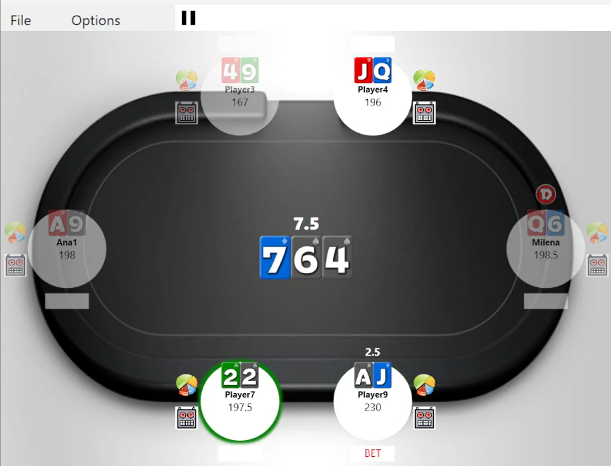
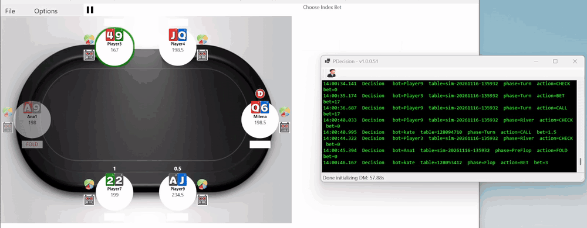

# simulator | Poker simulation and strategy libraries

> **Permitted use:** These bots may only be used for research, poker practice in the [simulator](https://github.com/biresevit/simulator-portfolio), poker practice through a real poker-site client, or authorized load testing to assess a poker site's stability under high traffic. Running bots at real-money tables without disclosing their use to all human players is prohibited.

> Public portfolio snapshot with a fresh history. Deployment credentials are removed; configuration placeholders require your own services. Binary dependencies and generated PDF guides are omitted.

A Windows poker simulator and shared .NET libraries for strategy decisions, hand-history parsing, player statistics, and regression analysis. The desktop simulator calls PDecision over REST or uses the decision library in process.



## Demo

The simulator (left) plays a six-handed table of bots. Each time a bot is to act, the simulator sends the table state to [PDecision](https://github.com/biresevit/PDecision-portfolio) over REST; the PDecision window (right) logs every decision it returns, and the simulator plays it at the table.



[Full-resolution video (MP4, 38 s)](images/simulator_demo.mp4)

## Engineering highlights

- A WPF table simulator for inspecting game state and exercising automated decisions.
- Shared strategy and evaluation libraries used by the PDecision service.
- Hand-history parsing and generation across multiple formats, with database-backed player statistics.
- Replay and regression workflows comparing simulated actions with recorded histories.

**Technology:** C#, VB.NET, .NET 8, WPF, SQL Server/LocalDB, NuGet.

## Repository map

| Directory | Responsibility |
| --- | --- |
| `PokerTable/` | Desktop simulator and REST integration |
| `DecisionMaking/` | Strategy, resources, table state, and statistics |
| `HandHistoryLib/` | Hand-history models and processing |
| `DBLib/` | VB.NET database and history-parsing components |
| `PokerUtil/` | Shared poker utilities |
| `QueryDBLib/` | Database query helpers |
| `RulesLib/` | Strategy rules |

## Platform context

```text
PokerTable -- REST --> PDecision --> DecisionMaking
     |                                   |
     +------ in-process decisions -------+
```

[PokerBackoffice](https://github.com/biresevit/PokerBackoffice) | [ScheduleController](https://github.com/biresevit/ScheduleController) | [PokerController](https://github.com/biresevit/PokerController) | [PDecision](https://github.com/biresevit/PDecision-portfolio) | [simulator](https://github.com/biresevit/simulator-portfolio)

The web operations interface lives in PokerBackoffice.

## Building

Use Windows and the .NET 8 SDK. PokerTable targets `net8.0-windows` and uses WPF. Some packages and project references require the existing development feeds, local package cache, or sibling shared projects. Strategy resources and runtime infrastructure are not bundled.

```powershell
dotnet build PokerTable/PokerTable/PokerTable.csproj -c Release
```

Inspect project references and NuGet sources before restoring. Runtime paths require configured strategy resources, SQL/LocalDB, and external solvers for applicable strategies. This repository is not a turnkey offline application.

## Simulation and validation

For REST integration, check out PDecision beside this repository and follow its simulator instructions. Start PDecision and wait for its health endpoint to report ready. PokerTable supports bot seats, pause/resume, fast execution, and switching between REST and in-process decisions.

PDecision's `tests/check_simulator_hh.py` compares recorded hand histories with the simulator's expected action trace. These integration checks require configured runtime resources.

## Configuration

Supply deployment credentials through local environment or secret configuration. Public portfolio copies contain configuration placeholders and require your own services and resources.

## Portfolio validation

Source scanning passed and DecisionMaking built successfully in the existing development environment. PokerTable cannot build without the omitted legacy WPF toolkit DLLs, including System.Windows.Controls.DataVisualization.Toolkit. Private packages and runtime resources are not bundled.
